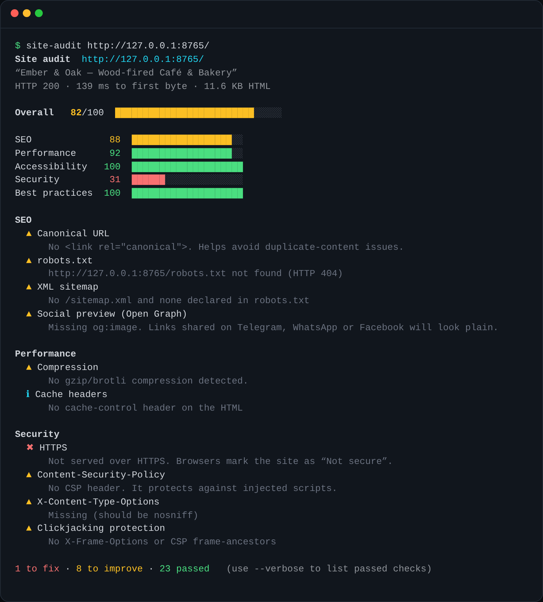
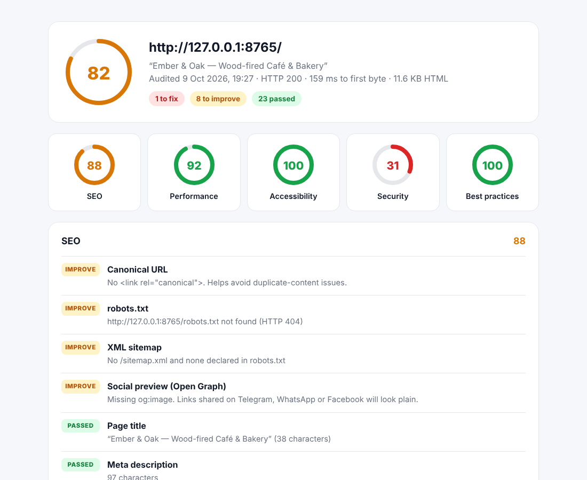

# site-audit-cli

A zero-dependency command-line tool that audits any web page for **SEO, performance, accessibility, security and best practices**, and produces a shareable HTML report.





See an [example HTML report](docs/example-report.html).

## Install

Requires Node.js 18.17 or newer.

```bash
git clone https://github.com/Manjak669/site-audit-cli.git
cd site-audit-cli
npm link          # makes the `site-audit` command available
```

## Usage

```bash
site-audit example.com
site-audit https://example.com --html report.html
site-audit example.com --json --min-score 80
```

| Option | What it does |
| --- | --- |
| `--html [file]` | Save a shareable HTML report |
| `--json` | Print the full result as JSON (for scripts) |
| `--min-score <n>` | Exit with code 1 if the score is below `n` (use it in CI) |
| `--timeout <sec>` | Request timeout, default 15 |
| `-v, --verbose` | Also list passed checks |

## What it checks (30+ checks)

- **SEO:** title and description length, single H1, canonical, noindex, robots.txt, sitemap, Open Graph tags, amount of text
- **Performance:** time to first byte, HTML weight, gzip/brotli, render-blocking scripts, lazy images, image dimensions, redirect chains, cache headers
- **Accessibility:** `lang`, image alt text, mobile viewport and zoom, heading order, form labels
- **Security:** HTTPS, HSTS, Content-Security-Policy, nosniff, clickjacking protection, mixed content, `target="_blank"` without `noopener`, `x-powered-by` leaks
- **Best practices:** HTTP status, doctype, charset, favicon, inline JS size, theme colour

Each category gets a 0–100 score, weighted by how much the issue matters.

## How it works

- Follows redirects manually to report the full chain and measure time to first byte
- A small purpose-built HTML scanner (`src/html.js`) ignores comments and script contents, so `"<h1>"` inside JavaScript is never counted as a heading
- The HTML report escapes all page content, so a malicious page can't inject scripts into your report

## Tests

```bash
npm test
```

The test suite starts a local HTTP server with good and bad fixture pages and checks every finding, redirects, error handling and HTML escaping. It uses only Node's built-in `node:test`.

## Need something like this?

I build web apps, tools and fast websites for small businesses and startups.

- Studio: [moonwave-studio.com](https://moonwave-studio.com)
- Hire me on [Upwork](https://www.upwork.com/freelancers/~01f7f6a71cc800d79b)

---

© MoonWave. All rights reserved. See [LICENSE](LICENSE).
